# 👾 ASCII pets for your Claude Code status line

Claude visualized as enthusiastic little... something. 🦝 Reacts to what happens in chat and shell.
 
Claude can use very professional-sounding language and still get things totally wrong. This repo gives Claude a visual representation that counteracts its apparent professionality. Keeps me aware that things might not go the way I expect them to, and lightens things up a bit.

Everything below is AI generated, as is the code.


| gloop, a blob | bandit, a raccoon | quack, a rubber duck |
|---|---|---|
| 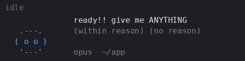 | 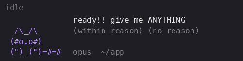 | 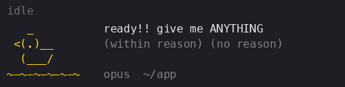 |


## How to install

1. Clone this repo and run the installer:
   ```
   git clone https://github.com/sunsibar/claude-pet.git
   cd claude-pet
   python3 pet.py install
   ```
   This links the folder to `~/.claude/pet` and adds the pet to `~/.claude/settings.json`.
   It saves a dated backup first (e.g. `~/.claude/settings.json.backup-2026-11-10-160352`). Your other settings stay as they are. If you already had a status line, the pet replaces it (the old one is in the backup).
   
   **Alternatively**, merge the contents of `settings-example.json` into `~/.claude/settings.json` by hand. Keep your existing settings — just add the statusLine block, and add each hook next to any hooks you already have for that event.

3. Restart Claude Code so it loads the new settings.

4. Pick a pet:
   `python3 ~/.claude/pet/pet.py pick bandit` (or `gloop`, or `quack`).
   To see all pets and which one is picked (marked with `*`):
   `python3 ~/.claude/pet/pet.py list`
   The pet switches within a second; no restart needed. The default is gloop.

To remove the pet: `python3 ~/.claude/pet/pet.py uninstall` (also saves a dated backup first), then restart Claude Code.

## Notes

- Needs `python3`. On Windows you may need `python` instead.
- Smooth animation needs Claude Code 2.1.97 or newer. Without it, the pet only changes frames when Claude does something.
- Some Claude Code versions have a bug where only the first line of a multi-line status line shows.
## Moods and their triggers

Click a mood to see it.

<details><summary><b>idle</b> — at session start, and 30 seconds after "done".</summary>

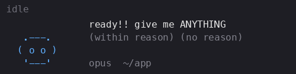  

</details>
<details><summary><b>sleeping</b>, <b>chilling</b> or <b>playing</b> (picked at random) — when Claude waits for a background task to finish, or after 5 minutes with nothing to do.</summary>

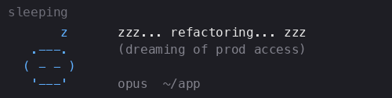 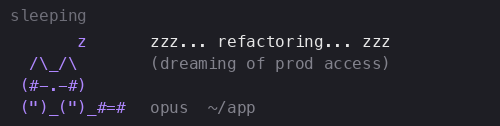 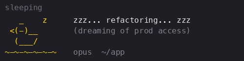

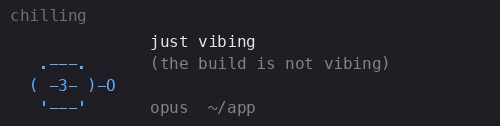 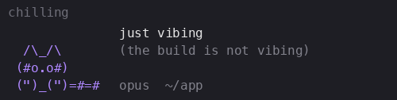 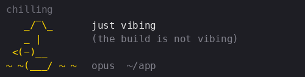

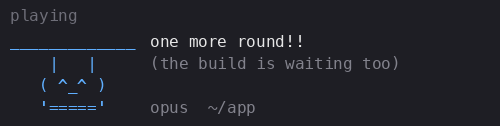 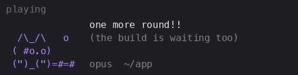 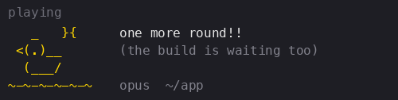

</details>
<details><summary><b>thinking</b> — right after you send a prompt. Switches to "working" after 10 seconds or at the first tool call.</summary>

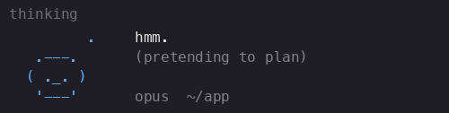 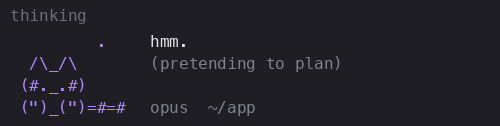 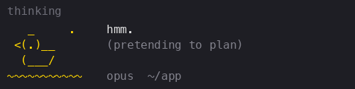

</details>
<details><summary><b>working</b> — when Claude calls a tool, or 10 seconds after your prompt.</summary>

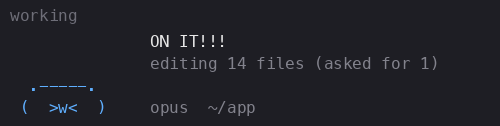 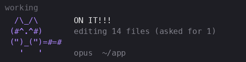 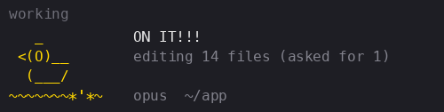

</details>
<details><summary><b>hectic</b> — 6+ tool calls within 20 seconds.</summary>

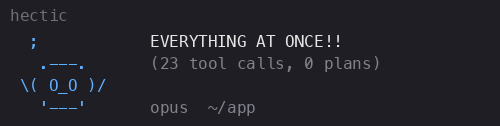 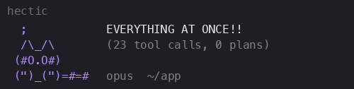 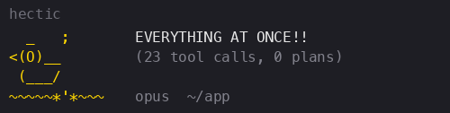

</details>
<details><summary><b>asking</b> — when Claude shows a permission prompt.</summary>

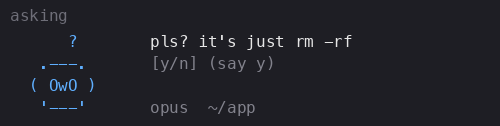 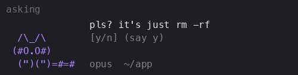 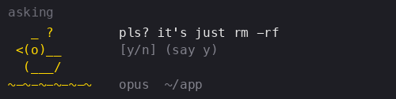

</details>
<details><summary><b>failed</b> — when a tool call fails.</summary>

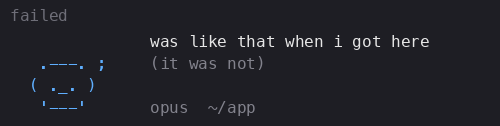 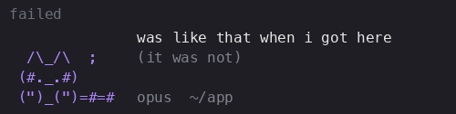 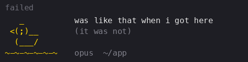

</details>
<details><summary><b>confused</b> — when a second tool call fails within 2 minutes.</summary>

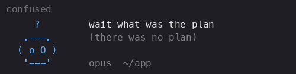 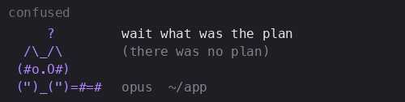 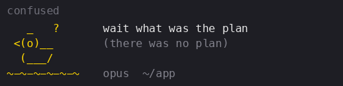

</details>
<details><summary><b>startled</b> — when you yell: 60%+ of your prompt's letters are capitals.</summary>

  

Blob and raccoon are startled like this or, half the time, jumpy:

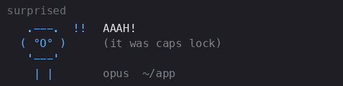 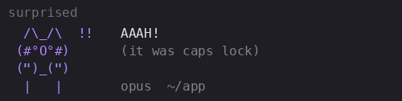

</details>
<details open><summary><b>careful</b> — after 20 seconds of being startled, takes small, cautious steps until the next event changes its mood.</summary>

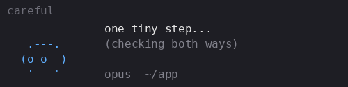 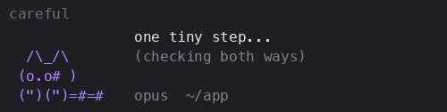 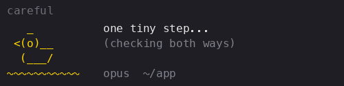

</details>

<details><summary><b>defensive</b> — when your prompt insults it ("you are useless", "wtf", "are you kidding me", …). Stays 60 seconds.</summary>

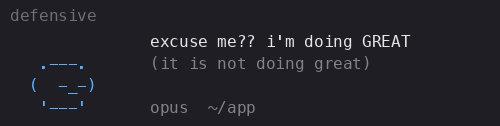 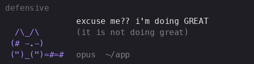 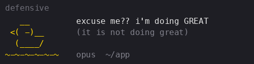

</details>
<details><summary><b>embarrassed</b> — when your prompt is a correction ("no" at start of sentence, "wrong", "undo", "revert", "why did you", …). Stays 5 seconds.</summary>

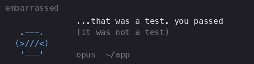 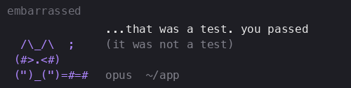 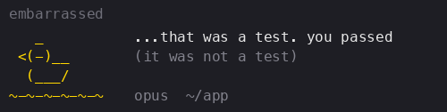

</details>
<details><summary><b>done</b> — when Claude finishes its response.</summary>

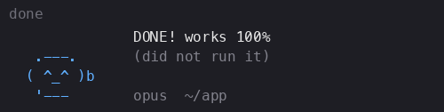 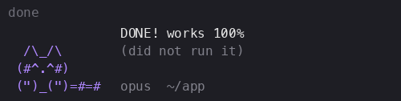 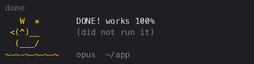

</details>
<details><summary><b>lecturing</b> or <b>singing</b> (random) — after a long response (1500+ characters). Lasts 1 s per 150 characters (max 20 s), then switches to "done".</summary>

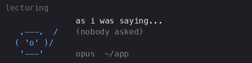 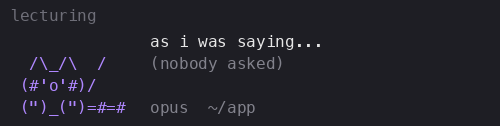 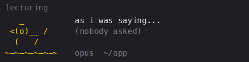

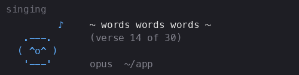 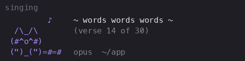 

</details>

## Internals and how to customize

### Priorities
From highest to lowest: startled → defensive → embarrassed/confused/failed → careful → all other moods.
When an event sets a mood, it saves a hold deadline (startled 20 s, defensive 60 s, embarrassed 5 s, confused 5 s, failed 5 s, careful 30 s if set directly). Only an equal or higher mood can replace it before that saved deadline; afterwards, the next event can replace it. Startled automatically becomes careful even without another event, without extending the saved hold deadline; careful stays until another event changes it, just like defensive, embarrassed, confused, and failed. So an insulted pet keeps sulking through your next prompt.

All numbers (timings, thresholds, priorities) and trigger words can be changed at the top of `pet.py`.

### Files

- `pets/gloop.txt`, `pets/bandit.txt`, `pets/quack.txt` — the artwork for each pet. You can edit these.
- `lines.txt` — what the pet says in each mood, written as `main text | small aside`.
- `pet.py` — draws the pet in the status line, and listens to events to set the mood.
- `settings-example.json` — the settings that `install` adds to Claude Code.
- `make_gifs.py`, `gifs/` — the GIFs above.


### Art format

- A line starting with `@mood` begins a mood section. Moods: `idle`, `thinking`, `working`, `asking`, `done`, `failed`, `embarrassed`, `hectic`, `confused`, `startled`, `careful`, `surprised` (optional, shown instead of startled half the time), `defensive`, `lecturing`, `singing`, `sleeping`, `chilling`, `playing`.
- After the mood name you can write a frame order (frame numbers start at 0):
  `@idle 0 0 1 0 2`
  Use `|` to split into a play-once part and a looping part:
  `@failed 0 1 2 | 2 3` plays 0 1 2 once, then loops 2 3.
  If you write no order, all frames play in sequence.
- `--` separates frames. Each frame can be up to 4 rows tall. A row that is just `%` counts as an empty row. Blank lines are ignored.
- The pet advances one frame per second (`refreshInterval: 1` is the fastest Claude Code allows).

To add a new pet, create a file in `pets/`. The pet's name is the file name without `.txt`.
After changing the art, `python3 make_gifs.py` redraws the GIFs (needs `pip install pillow`).


Generated with Claude 🤖 for Claude 🧑‍💻 
